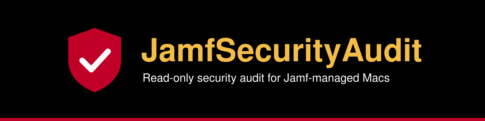

<p align="center"></p>

<p align="center">
  
  
  
  
</p>

<p align="center">
  <a href="#quick-start">Quick start</a> ·
  <a href="#what-it-checks">What it checks</a> ·
  <a href="#how-a-run-works">How a run works</a> ·
  <a href="#limitations">Limitations</a> ·
  <a href="#reference">Reference</a>
</p>

JamfSecurityAudit checks one Mac for 30 common security gaps in Jamf-managed Macs. It reads the state of the Mac, changes nothing and writes a private HTML report. The audit is a single JavaScript for Automation (JXA) script, so it runs on stock macOS with no Python, Homebrew or Jamf credentials.


<p align="center"><sub>An example report. The data comes from an invented demo Mac.</sub></p>

## Quick start

1. Clone the repository.

   ```sh
   git clone https://github.com/Dominic-Ferri/JamfSecurityAudit.git
   cd JamfSecurityAudit
   ```

2. Build the app. The script saves `JamfSecurityAudit.app` on your Desktop.

   ```sh
   ./build_jamf_security_audit_app.sh
   ```

3. Double-click `JamfSecurityAudit.app`. A Terminal window opens.
4. Enter your admin password for full coverage. To run with reduced coverage, press Ctrl-C at the password prompt.
5. Read the report. The launcher opens it when the run ends.

## What it checks

The audit runs 30 checks in seven areas. Rule IDs stay the same across releases. Expect gaps in the numbering.

| Rule | Finding | Severity |
| --- | --- | --- |
| **FileVault** | | |
| FV-01 | FileVault is off | **Critical** |
| FV-03 | FileVault is on but no personal recovery key exists | **Critical** |
| FV-04 | No recovery-key escrow profile is installed | Medium |
| **MDM health** | | |
| MDM-02 | The Mac lacks user-approved MDM | Medium |
| MDM-03 | No bootstrap token is escrowed | Medium |
| **Accounts** | | |
| ACC-01 | The signed-in user is a local administrator | High |
| ACC-02 | Local account records are broken (no UID) | High |
| ACC-03 | No working admin account for IT | High |
| ACC-06 | The Guest account is on | Medium |
| ACC-07 | Automatic login is on | High |
| ACC-08 | A Platform SSO profile makes users administrators | High |
| DIR-01 | The Mac is bound to Active Directory | Low |
| DIR-02 | The AD binding makes directory groups local administrators | Medium |
| **Remote access** | | |
| NET-01 | The macOS firewall is off | High |
| NET-02 | SSH (Remote Login) is on | High |
| NET-03 | Screen Sharing or Remote Management is on | Medium |
| NET-04 | Third-party remote-control software is installed | Medium |
| NET-05 | A Wi-Fi profile defines an open network | Medium or Low |
| NET-06 | A Wi-Fi profile disables Private Wi-Fi Address | Low or Medium |
| NET-07 | Enterprise Wi-Fi does not pin its RADIUS server certificate | High |
| **Updates** | | |
| OS-01 | The Mac misses fixes for actively exploited vulnerabilities | **Critical** |
| OS-02 | The Mac is behind the latest security release for its macOS version | High |
| OS-03 | The Mac runs a macOS version that no longer gets security updates | High |
| **Platform security** | | |
| SEC-01 | SIP or Gatekeeper is off | High |
| SEC-02 | Activation Lock is on | Medium |
| SEC-04 | No profile requires a password soon after the screen saver starts | Medium |
| SEC-05 | No password policy applies | High |
| **Profiles** | | |
| PRF-01 | Installed profiles set the same key to different values | High |
| PRF-04 | A privacy profile gives Full Disk Access to Terminal or a script interpreter | High |
| PRF-06 | A privacy profile gives remote-control apps full disk, screen and accessibility access | Medium |

NET-05 is Low when every open network in the profiles has AutoJoin off. NET-06 is Medium when the network is also open.

Each check ends as PASS, FAIL, SKIP or ERROR. The audit skips a check when it cannot get reliable evidence. A skipped check never counts as a pass.

[RULE_SOURCES.md](RULE_SOURCES.md) quotes the Apple, Jamf and Microsoft sources behind the rule text.

## How a run works

The app opens a Terminal window and runs the audit there. Enter your admin password for full coverage. If you press Ctrl-C at the password prompt, the audit runs without admin rights.

Some checks need root. These checks read computer-level profiles, the bootstrap token and the FileVault recovery key. Without the admin password, the audit skips these checks and marks the report incomplete.

The launcher verifies the code signature of the app before it asks for the password. If the signature does not verify, the audit runs without admin rights.

### Where the report goes

The launcher saves each report in `~/Library/Logs/JamfSecurityAudit`. The folder has mode 700 and each report has mode 600. The launcher opens the report when the run ends.

The report names the Mac, its accounts and its weaknesses. For this reason, the report stays out of the Desktop and Documents folders, which iCloud can sync.

Under sudo, the audit writes into a temporary folder that only root can read. Your own shell then copies the report into the log folder. Root never writes into a folder that you can change.

## Limitations

- The audit sees only this Mac. It cannot read Jamf server settings such as SSO, API clients, scopes, Recovery Lock or LAPS state.
- Without the admin password, the audit skips several checks.
- NET-04 matches known product names in application, launchd and `/opt` folders. It does not find renamed or unlisted tools.
- The Wi-Fi checks read installed profiles. They do not check networks that a user added by hand.
- The OS checks depend on the SOFA feed. The audit skips a macOS version that is newer than the feed.
- Slow commands stop after 60 seconds. The audit skips a check that times out.

## Signing and quarantine

The app has an ad-hoc signature. It has no Developer ID, and Apple has not notarized it. A copy that you build yourself has no quarantine flag and opens normally.

macOS quarantines a copy that you download from elsewhere, so Gatekeeper blocks it. To allow it once, open System Settings > Privacy & Security. Then click Open Anyway. A build from source avoids this step.

## Reference

<details>
<summary><b>Command-line options</b></summary>

```sh
osascript -l JavaScript jamf_host_audit.js --html out.html \
  [--json out.json] [--assets report_assets.json] [--offline]
```

| Option | Effect |
| --- | --- |
| `--html FILE` | Writes the HTML report. |
| `--json FILE` | Writes the same results as JSON. |
| `--assets FILE` | Adds the report stylesheet and source titles from `report_assets.json`. |
| `--offline` | Skips the SOFA download. The audit then skips the update checks. |

Run the command with `sudo` for full coverage. The command prints one line for each check that did not pass. A summary line follows. The command exits 0 when the audit completes, even with findings. It exits non-zero only when the audit itself fails.

</details>

<details>
<summary><b>Build the app</b></summary>

```sh
./build_jamf_security_audit_app.sh [DEST_DIR]
```

The script compiles the AppleScript launcher. It copies the audit script, the launcher and `report_assets.json` into the bundle. Then it signs the bundle with an ad-hoc signature.

The default destination is `~/Desktop`. The script renames an existing app at the destination with a `.bak` timestamp. It does not overwrite the existing app.

`osacompile` writes the macOS version of the build Mac into the launcher as its minimum version. Build the app on the oldest macOS version that you must support. On a newer Mac, run the audit script directly with `osascript -l JavaScript jamf_host_audit.js`.

</details>

<details>
<summary><b>Run the tests</b></summary>

```sh
/usr/bin/python3 -I test_jamf_host_audit.py
```

The tests replay recorded command output through the `--fixture` option. They need no admin rights, and they do not read the real state of the Mac.

The audit accepts `--fixture` only when the environment sets `JAMF_HOST_AUDIT_FIXTURE=1`. The tests set this variable for you.

</details>

<details>
<summary><b>The SOFA feed</b></summary>

SOFA is a public macOS update feed from the Mac Admins community. It lists each macOS security release and the CVEs that Apple says may have been exploited. The update checks compare the macOS version of this Mac with that list.

The audit downloads the feed from `https://sofafeed.macadmins.io/v1/macos_data_feed.json` over HTTPS. This download is the only network call. The audit sends no data about the Mac.

</details>

<details>
<summary><b>Rule sources</b></summary>

[RULE_SOURCES.md](RULE_SOURCES.md) records the primary sources behind the explanatory text of each rule. Each section quotes the Apple, Jamf or Microsoft pages and gives a verdict on an earlier draft of the rule text. Pages change, so check the live page before you rely on a quote.

</details>
